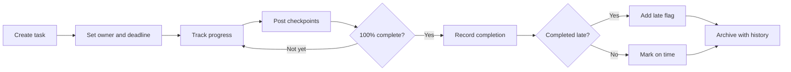

<div align="center">

# ViDo

### See the work. Share the progress. Deliver together.

A modern task-management workspace built for focused individuals and transparent teams.

[](#roadmap)
[](https://vite.dev/)
[](https://react.dev/)
[](https://www.typescriptlang.org/)
[](https://supabase.com/)

[Vision](./Idea.md) · [Features](#features) · [Roadmap](#roadmap) · [Tech Stack](#tech-stack)

</div>

---

## Why ViDo?

A checkbox tells you that something is done. It does not tell you **how the work is going**.

ViDo gives every task a precise deadline, measurable progress, a clear owner, and a timestamped history. Individuals stay focused in a private workspace while teams coordinate from a shared source of truth—without turning every update into another meeting.

> **ViDo turns “What is the status?” into a question the workspace already answers.**

## Built as a Learning Journey

ViDo is more than a finished application. It is designed as a transparent, four-phase case study in AI-assisted software development. Each milestone will preserve its code, prompts, demonstration, and a self-contained technical article so learners can follow the product as it evolves from a minimal to-do list into a collaborative system.

```text
Minimal tasks  →  Multi-user login  →  Shared tasks + threads  →  AI recommendations
```

## The Experience

<table>
<tr>
<td width="50%" valign="top">

### 👤 My Tasks

A private space for personal planning.

- Organize individual responsibilities
- Set exact dates and deadline times
- Track progress from 0% to 100%
- Keep a chronological update history
- Separate active, overdue, and completed work

</td>
<td width="50%" valign="top">

### 👥 Team Tasks

A shared space for coordinated execution.

- Create focused team workspaces
- Invite registered collaborators
- Delegate tasks with clear ownership
- Follow progress and threaded updates
- Stay synchronized in real time

</td>
</tr>
</table>

## Features

### ✅ Task Management

- Create, edit, complete, archive, and delete tasks
- Set precise target dates and times
- Measure incremental progress instead of relying on binary status
- Detect overdue work automatically
- Flag tasks completed after their deadlines

### 📝 Progress Checkpoints

- Post timestamped task updates
- Record the progress percentage at each checkpoint
- Preserve comments, decisions, and blockers
- Retain the complete history after task completion

### 🔐 Identity and Privacy

- Authenticate securely with email and password
- Persist user data across sessions
- Isolate private tasks by authenticated user ID
- Enforce access control at the database layer

### 🤝 Team Collaboration

- Create and manage team workspaces
- Invite members through registered email addresses
- Assign tasks to specific collaborators
- Monitor shared progress and updates
- Receive real-time changes without manual refreshing

### ✨ AI Agent — The Flagship Phase

- Generate context-aware tasks from goals, schedules, and recent activity
- Recommend relevant follow-up actions automatically
- Surface deadline, dependency, and workload risks
- Break broad goals into actionable steps
- Summarize recent personal and team activity
- Continuously improve recommendations using task context and progress history

The embedded AI agent is ViDo’s defining capability and the most important phase of the project. Its recommendations must remain explainable and user-approved—the agent should assist decisions without silently changing tasks or assignments.

### Initial AI Dataset

Phase 4 will initially use a two-year household-task dataset containing **1,786 task records** across **20 recurring task types**. It includes task creation, deadline, and completion dates, providing a practical starting point for learning recurrence patterns, completion delays, deadline risk, and next-task recommendations.

The dataset is a foundation for experimentation, not the final intelligence layer. ViDo will later enrich recommendations using authenticated user context, progress checkpoints, team activity, and live schedules.

## How a Task Flows



Task views are calculated from real task data:

- 🟡 **Pending** — incomplete and still within the deadline
- 🔴 **Overdue** — incomplete and past the deadline
- 🟢 **Completed** — finished with full history and delivery timing

## Roadmap

- [ ] **Milestone 1 — Minimal Task Management Core**
  A focused to-do experience with task lifecycle, precise deadlines, progress percentages, checkpoints, status views, completion tracking, and archiving.

- [ ] **Milestone 2 — Authentication and Multi-User Support**
  Secure sign-in, persistent profiles, cloud data, sessions, and strict user-level isolation.

- [ ] **Milestone 3 — Shared Tasks and Team Collaboration**
  Shared tasks across users, teams, invitations, assignment, comments, threaded replies, progress updates, and real-time synchronization.

- [ ] **Milestone 4 — Embedded AI Agent and Recommendations** ⭐
  The flagship milestone: context-aware task generation, workload and deadline analysis, intelligent follow-up actions, activity summaries, and a deeply integrated recommendation agent.

## Tech Stack

| Layer | Technology | Purpose |
|---|---|---|
| Frontend | Vite + React | Fast, component-driven web experience |
| Language | TypeScript | Safer and more maintainable application code |
| Data | Supabase PostgreSQL | Persistent relational task and workspace data |
| Authentication | Supabase Auth | Secure email and password identity |
| Authorization | Row-Level Security | Server-side user and team data isolation |
| Collaboration | Supabase Realtime | Live task and checkpoint updates |

> The frontend stack is selected. Supabase is the proposed backend direction and may evolve as development progresses.

## Product Principles

```text
Clarity over complexity      History over guesswork
Privacy by default           Collaboration without noise
Trustworthy foundations      AI that drives useful action
```

## Project Status

ViDo is currently in the **planning and product-definition phase**. The original discussion has been distilled into the product vision and four-stage roadmap; application scaffolding and Milestone 1 implementation come next.

Each milestone will aim to produce:

- A preserved, working code snapshot
- A record of the important AI prompts
- A concise build and feature-demonstration video
- A polished technical article that stands on its own

Read the complete product and learning vision in **[Idea.md](./Idea.md)**.

---

<div align="center">

**ViDo** · Progress made visible

</div>
